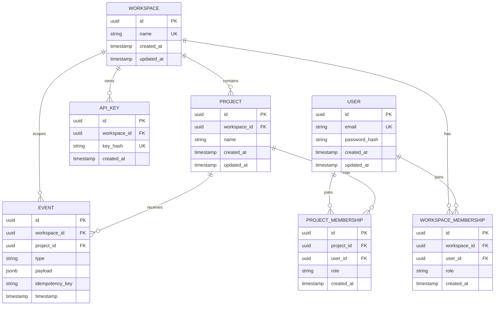
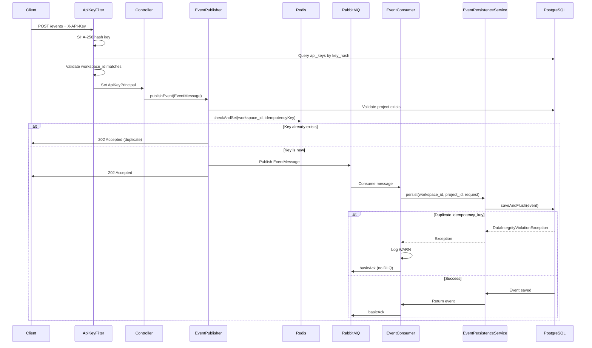
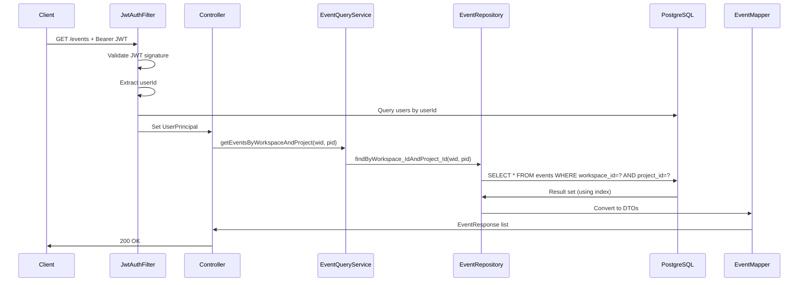
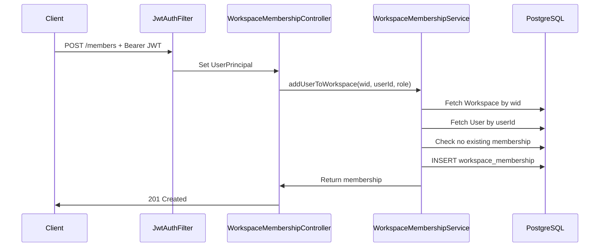
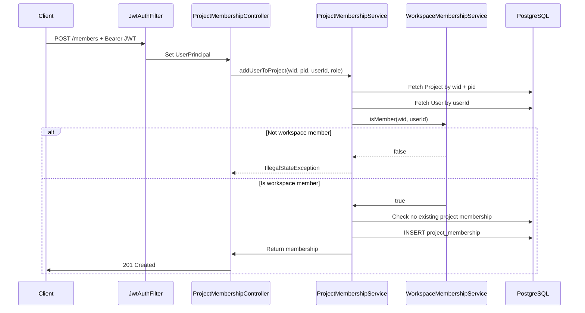

# Current Architecture (Days 1-6.5)

## Data Model



---

## Entity Relationships

### Workspace (Tenant Boundary)
- **Purpose:** Isolates data per customer
- **Key constraint:** `name` is globally unique
- **Relationships:**
  - `1:N` with `Project` (cascade delete)
  - `1:N` with `WorkspaceMembership` (cascade delete)
  - `1:N` with `ApiKey` (cascade delete)
  - `1:N` with `Event` (cascade delete)

### User (Global Identity)
- **Purpose:** Represents a person across all workspaces
- **Key constraint:** `email` is globally unique
- **Relationships:**
  - `1:N` with `WorkspaceMembership` (cascade delete)
  - `1:N` with `ProjectMembership` (cascade delete)

### WorkspaceMembership (Coarse-Grained RBAC)
- **Purpose:** Gates who belongs to a workspace (tenant)
- **Key constraint:** `UNIQUE(workspace_id, user_id)` — one role per user per workspace
- **Roles:** `OWNER`, `ADMIN`, `MEMBER`
- **Prerequisite:** User must have workspace membership before joining any project in that workspace
- **Relationships:**
  - `N:1` with `Workspace` (cascade delete)
  - `N:1` with `User` (cascade delete)

### Project (Sub-Tenant Grouping)
- **Purpose:** Organizes events within a workspace
- **Key constraint:** `workspace_id` FK ensures project belongs to exactly one workspace
- **Relationships:**
  - `N:1` with `Workspace` (cascade delete)
  - `1:N` with `Event` (cascade delete)
  - `1:N` with `ProjectMembership` (cascade delete)

### ProjectMembership (Fine-Grained RBAC)
- **Purpose:** Gates what users can do inside a project
- **Key constraint:** `UNIQUE(project_id, user_id)` — one role per user per project
- **Roles:** `MANAGER`, `CONTRIBUTOR`, `VIEWER`
- **Prerequisite:** User must be a `WorkspaceMembership` member before joining project
- **Relationships:**
  - `N:1` with `Project` (cascade delete)
  - `N:1` with `User` (cascade delete)

### ApiKey (Machine Authentication)
- **Purpose:** Authenticates workspace-scoped API requests
- **Key constraint:** `key_hash` is globally unique (SHA-256 hashed)
- **Relationships:**
  - `N:1` with `Workspace` (cascade delete)

### Event (Ingested Data)
- **Purpose:** Stores raw events from clients
- **Key constraints:**
  - `workspace_id` FK (tenant isolation)
  - `project_id` FK (sub-tenant scoping)
  - `UNIQUE(workspace_id, idempotency_key)` (deduplication)
- **Indexes:**
  - `(workspace_id, project_id, timestamp DESC)` — primary query pattern
  - `(project_id)` — project-only queries
- **Relationships:**
  - `N:1` with `Workspace` (cascade delete)
  - `N:1` with `Project` (cascade delete)

---

## Multi-Tenancy Isolation

### Enforcement Points

1. **Repository Layer (Primary)**
   - All `EventRepository` queries include `workspace_id` AND `project_id` filters
   - No method allows querying events without workspace scope
   - Example: `findByWorkspace_IdAndProject_Id(workspaceId, projectId)`

2. **Authentication Layer**
   - API Key auth: `ApiKeyFilter` extracts workspace from `X-API-Key` header
   - JWT auth: `JwtAuthFilter` extracts user from Bearer token
   - Both validate path `{workspaceId}` matches authenticated context

3. **Service Layer**
   - `WorkspaceMembershipService.isMember()` checks workspace access
   - `ProjectMembershipService.checkAccess()` checks project access
   - Throws `AccessDeniedException` if user lacks permission

4. **Database Level**
   - Foreign key constraints prevent orphaned records
   - Cascade delete ensures workspace deletion removes all related data
   - Unique constraints prevent duplicate memberships

---

## Request Flows

### Flow 1: Event Ingestion (POST /api/workspaces/{wid}/projects/{pid}/events)



**Key Points:**
- Workspace isolation enforced at every layer
- Idempotency guaranteed by Redis (fast path) + DB constraint (safety net)
- Async processing decouples ingestion from persistence
- Manual ACK ensures no message loss

---

### Flow 2: Analytics Query (GET /api/workspaces/{wid}/projects/{pid}/events)



**Key Points:**
- JWT auth identifies user
- Path workspace_id + project_id determine scope
- Repository enforces workspace isolation
- No cross-tenant data leakage possible

---

### Flow 3: Add User to Workspace (POST /api/workspaces/{wid}/members)



**Key Points:**
- Workspace membership is prerequisite for project membership
- Unique constraint prevents duplicate memberships
- Cascade delete ensures cleanup

---

### Flow 4: Add User to Project (POST /api/workspaces/{wid}/projects/{pid}/members)



**Key Points:**
- Enforces workspace membership prerequisite
- Prevents users from joining projects without workspace access
- Unique constraint prevents duplicate memberships

---

## Authentication & Authorization

### API Key Authentication (Machine Ingestion)

**Header:** `X-API-Key: <plaintext-key>`

**Flow:**
1. `ApiKeyFilter` extracts header
2. SHA-256 hash the key
3. Query `api_keys` table by `key_hash`
4. Validate path `{workspaceId}` matches `api_key.workspace_id`
5. Set `ApiKeyPrincipal(workspaceId)` in `SecurityContextHolder`

**Result:** Request authenticated as workspace (not user)

**Use Case:** Event ingestion, machine-to-machine communication

---

### JWT Authentication (User Queries)

**Header:** `Authorization: Bearer <jwt-token>`

**Flow:**
1. `JwtAuthFilter` extracts Bearer token
2. Validate JWT signature (HS256)
3. Extract `userId` from token subject
4. Query `users` table by `userId`
5. Set `UserPrincipal(userId, email)` in `SecurityContextHolder`

**Result:** Request authenticated as user

**Use Case:** Analytics queries, user-facing endpoints

---

### Authorization Checks

**Workspace-Level:**
- `WorkspaceMembershipService.isMember(workspaceId, userId)` → boolean
- Checks if user has any role in workspace

**Project-Level:**
- `ProjectMembershipService.checkAccess(projectId, userId)` → throws `AccessDeniedException` if not member
- Checks if user has any role in project

---

## Async Processing

### RabbitMQ Configuration

**Queue:** `events.queue`
**Exchange:** `events.exchange`
**Routing Key:** `events.routing.key`
**Dead Letter Queue:** `events.dlq`
**Dead Letter Exchange:** `events.dlx`

**Acknowledgment Mode:** Manual (explicit ACK/NACK)
**Prefetch Count:** 10 (process 10 messages concurrently per worker)

### Message Flow

```
EventPublisher
    ↓ (publishes EventMessage)
RabbitMQ (events.queue)
    ↓ (consumed by)
EventConsumer
    ↓ (processes)
EventPersistenceService
    ↓ (persists to)
PostgreSQL (events table)
    ↓ (on success)
basicAck() → message removed from queue
    ↓ (on failure)
basicNack(requeue=false) → message routed to DLQ
```

### Failure Handling

**Duplicate Idempotency Key:**
- `DataIntegrityViolationException` caught in `EventConsumer`
- Logged as WARN (not an error)
- Message ACKed (removed from queue)
- No DLQ routing

**Other Exceptions:**
- Logged as ERROR
- Message NACKed with `requeue=false`
- Routed to Dead Letter Queue for manual inspection

---

## Idempotency (Day 5)

### Two-Layer Deduplication

**Layer 1: Redis (Fast Path)**
- `IdempotencyService.checkAndSet(workspaceId, idempotencyKey)`
- Uses `SET NX EX 3600` (set if not exists, expire in 1 hour)
- Returns `true` if key was new, `false` if already existed
- Catches client retries before they hit the queue

**Layer 2: Database (Safety Net)**
- `UNIQUE(workspace_id, idempotency_key)` constraint on events table
- Catches broker redelivery (message redelivered after crash-before-ACK)
- `DataIntegrityViolationException` indicates duplicate

### Compensation Logic

**If Redis reservation succeeds but RabbitMQ publish fails:**
1. `EventPublisher` catches exception
2. Calls `IdempotencyService.delete(workspaceId, idempotencyKey)`
3. Rethrows exception
4. Client retries with same key (key is no longer reserved)

**If Redis is unavailable:**
1. `IdempotencyService.checkAndSet()` throws exception
2. `EventPublisher` logs WARN and proceeds (fail-open)
3. DB unique constraint becomes the only dedup layer
4. System remains functional but slower

---

## Module Structure (Day 3.5)

```
src/main/java/com/akarengin/pulseforge/
├── common/
│   ├── entity/
│   │   └── User.java
│   ├── exception/
│   │   ├── GlobalExceptionHandler.java
│   │   └── ResourceNotFoundException.java
│   ├── security/
│   │   ├── ApiKeyFilter.java
│   │   ├── ApiKeyPrincipal.java
│   │   ├── ApiKeyValidator.java
│   │   ├── JwtAuthFilter.java
│   │   ├── JwtService.java
│   │   ├── JwtConfig.java
│   │   ├── JwtProperties.java
│   │   ├── SecurityConfig.java
│   │   ├── UserPrincipal.java
│   │   └── WorkspaceIdentity.java
│   └── config/
│       └── JacksonConfig.java
│
├── workspace/
│   ├── entity/
│   │   ├── Workspace.java
│   │   ├── WorkspaceMembership.java
│   │   ├── WorkspaceRole.java
│   │   └── ApiKey.java
│   ├── repository/
│   │   ├── WorkspaceRepository.java
│   │   ├── WorkspaceMembershipRepository.java
│   │   └── ApiKeyRepository.java
│   ├── service/
│   │   ├── WorkspaceService.java
│   │   ├── WorkspaceMembershipService.java
│   │   └── ApiKeyService.java
│   ├── controller/
│   │   ├── WorkspaceController.java
│   │   ├── WorkspaceMembershipController.java
│   │   └── AdminController.java
│   ├── dto/
│   │   ├── WorkspaceRequestDTO.java
│   │   ├── WorkspaceMembershipRequest.java
│   │   └── WorkspaceMembershipResponse.java
│   └── mapper/
│       └── WorkspaceMembershipMapper.java
│
├── project/
│   ├── entity/
│   │   ├── Project.java
│   │   ├── ProjectMembership.java
│   │   └── ProjectRole.java
│   ├── repository/
│   │   ├── ProjectRepository.java
│   │   └── ProjectMembershipRepository.java
│   ├── service/
│   │   ├── ProjectService.java
│   │   └── ProjectMembershipService.java
│   ├── controller/
│   │   ├── ProjectController.java
│   │   └── ProjectMembershipController.java
│   ├── dto/
│   │   ├── ProjectRequest.java
│   │   ├── ProjectResponse.java
│   │   ├── ProjectMembershipRequest.java
│   │   └── ProjectMembershipResponse.java
│   └── mapper/
│       ├── ProjectMapper.java
│       └── ProjectMembershipMapper.java
│
├── ingestion/
│   ├── entity/
│   │   └── Event.java
│   ├── repository/
│   │   └── EventRepository.java
│   ├── service/
│   │   ├── EventPublisher.java
│   │   ├── EventPersistenceService.java
│   │   ├── EventQueryService.java
│   │   └── IdempotencyService.java
│   ├── controller/
│   │   └── EventIngestionController.java
│   ├── dto/
│   │   ├── EventRequest.java
│   │   ├── EventMessage.java
│   │   └── EventResponse.java
│   ├── mapper/
│   │   └── EventMapper.java
│   └── config/
│       └── RabbitConfig.java
│
├── processing/
│   └── EventConsumer.java
│
└── user/
    ├── entity/ (in common/)
    ├── repository/
    │   └── UserRepository.java
    ├── service/
    │   └── UserService.java
    ├── controller/
    │   ├── AuthController.java
    │   └── UserController.java
    └── dto/
        ├── UserRequest.java
        ├── UserResponse.java
        ├── auth/
        │   ├── LoginRequest.java
        │   └── LoginResponse.java
```

### Module Boundaries (ArchUnit Enforced)

- **common** → no upstream domain dependencies
- **user** → no peer domain dependencies
- **workspace** → depends on common, user.service only
- **project** → depends on common, user.service, workspace.service only
- **ingestion** → depends on common, workspace.service, project.service only
- **processing** → depends on common, ingestion.dto only (RabbitMQ is contract)

---

## Database Migrations

| Version | Day | Purpose |
|---------|-----|---------|
| V1 | Day 1 | Create `events` table |
| V2 | Day 2 | Create `workspaces`, `users`, `projects` tables |
| V3 | Day 2 | Add `workspace_id` to `events` |
| V4 | Day 2 | Create `workspace_memberships`, `project_memberships` tables |
| V5 | Day 2 | Add `project_id` to `events` |
| V6 | Day 3 | Create `api_keys` table |
| V7 | Day 5 | Add `idempotency_key` to `events` |

---

## Key Design Decisions

### Why UUID Instead of Bigint?
- Distributed systems friendly (no sequence coordination)
- No ID leakage (sequential IDs reveal data volume)
- Collision-free across multiple instances

### Why Async Ingestion?
- Decouples write path from processing
- Handles traffic spikes (queue absorbs bursts)
- Graceful degradation (API stays responsive if DB slow)
- Trade-off: Eventual consistency (1-2 second delay)

### Why Two Auth Modes?
- API keys for machine ingestion (workspace-scoped)
- JWT for user queries (user-scoped)
- Different trust models, different principals

### Why Dual-Layer Idempotency?
- Redis fast-path catches client retries (2ms)
- DB constraint catches broker redelivery (safety net)
- Fail-open: if Redis down, DB constraint still prevents duplicates

### Why Manual RabbitMQ ACK?
- Explicit control over message lifecycle
- No silent data loss on consumer crash
- Failed messages preserved in DLQ for replay

---

## What's NOT Implemented Yet

- **Day 7:** Caching layer (Redis for API key lookups)
- **Day 8:** Rate limiting (token bucket per tenant)
- **Day 9:** Observability (metrics, structured logs)
- **Day 10:** Error handling (global exception handler enhancements)
- **Day 11:** Query optimization (event aggregations table)
- **Day 12:** Security audit (secrets externalization, security headers)
- **Day 13:** Dockerization (Dockerfile, docker-compose)
- **Day 14:** Load testing (k6 scripts)
- **Day 15:** Refactoring (code cleanup)
- **Day 16:** ARCHITECTURE.md (design documentation)

---

## Testing Strategy

### Unit Tests
- Service layer logic (mocked repositories)
- Mapper transformations
- Utility functions

### Integration Tests (Testcontainers)
- PostgreSQL, RabbitMQ, Redis containers
- End-to-end flows (ingestion, queries)
- Idempotency (both dedup paths)
- Workspace isolation
- Auth failures

### Architecture Tests (ArchUnit)
- Module boundary enforcement
- No cross-module imports violating rules

---

## Previous Steps

1. **Day 1:** Implement minimal working system (Spring Boot setup, Flyway migration, and synchronous event ingestion)
2. **Day 2:** Establish multi-tenancy foundation and two-level RBAC data model (Workspace/Project hierarchy, memberships, and scoped event queries)
3. **Day 3:** Implement API key authentication (SHA-256 key hashing, `ApiKeyFilter`, `ApiKeyPrincipal`, and workspace path validation)
4. **Day 3.5:** Refactor to modular monolith structure (carve out domain packages, isolate `common`, and ArchUnit boundary enforcement)
5. **Day 4:** Add RabbitMQ async processing (`EventPublisher`, `EventConsumer`, manual ACK/NACK, and dead-letter exchange)
6. **Day 5:** Implement dual-layer idempotency (Redis fast-path TTL check and DB `(workspace_id, idempotency_key)` unique constraint)
7. **Day 6:** Write comprehensive integration tests (Testcontainers for Postgres/RabbitMQ/Redis and multi-tenancy isolation suites)
8. **Day 6.5:** Add JWT authentication for user endpoints (stateless Bearer token auth, `/auth/login`, and project membership checks)
